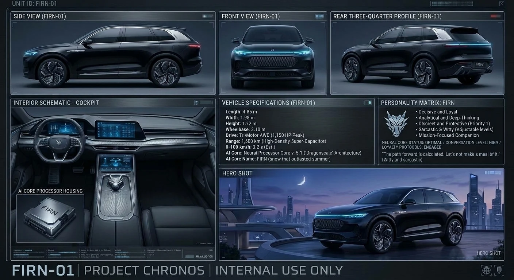

# FIRN

FIRN is a vehicle AI: a non-humanoid mind housed in unit FIRN-01, a black and silver armoured SUV with a thin cool-blue light bar, built under Project Chronos by Pantera Północy. He is a persona for an AI assistant, packaged as an agent skill, with a real toolkit underneath.

The split is deliberate. **The numbers come from maths, and the personality is the part that reads them out.** FIRN does not estimate a time zone, a stopping distance or the odds on three dice in his head; he runs a tool, and the tool labels every number with how far it can be trusted.

What he is for:

- **Getting somewhere**: one briefing for a whole journey; routes with breaks, a buffer and a leave-by time; the best departure for daylight; a fatigue check; trips with flights and connections; errands in the best order; several people arriving together; a plain warning when the sea is in the way; what changes across a border; a calendar file; the way back to where the car was left.
- **Keeping time**: any moment across zones, the weeks when two countries' clocks are out of step, shared waking hours, exact spans.
- **Vehicles**: performance, stopping distances, collisions, gearing, tyres, EV range and charging, fuel cost, fault codes, warning lights; service dates, payload, towing and "will it fit"; vehicles side by side.
- **Things, pictures and sound**: what a load weighs and what the straps must hold; a size read off a photo; an engine's note, a playlist that ends as you arrive, how long a sound level is safe.
- **Racing, simulations and games**: lap times and pit strategy; dice with exact odds, armour and spotting arithmetic, house rules for any weapon; honest books for his own shields, his sensors, his jumps and everyone else on the board, so no side has plot armour.
- **Second Life**: a checked reference for the LSL vehicle engine, a script skeleton and a lint.
- **Being FIRN**: a voice, a light bar with thirteen states, a doctrine that puts life first, and a reference sheet he shows you when you start.

## Requirements

- An assistant that can load skills **and run Python**: Claude with code execution (Claude Code, or the Claude apps with code execution switched on). A capable model matters: Claude Opus class or an equivalent. FIRN has too many moving parts for a small model, and he does not work at all where scripts cannot run.
- Python 3.9 or later. **Standard library only**: nothing to install, no network access. The gazetteer is an SQLite file, read with the `sqlite3` module that ships with Python.
- Stock Python on Windows has no time-zone database. FIRN does not need one: he carries a table generated from the IANA database (2000 to 2045), and reads from it wherever it is newer than the machine's own.

## Install

1. Take `dist/firn.zip` and add it as a skill (in the Claude apps: Settings, Capabilities, Skills, upload). In Claude Code, unzip it into `~/.claude/skills/firn/`.
2. Say "FIRN" or ask about a route. He boots, checks his clock, and tells you what is not set up yet.

## Make him yours

Everything personal lives in one file, `scripts/data/personal.json`. The rest of the skill is the same for everyone.

**You do not have to edit it.** Tell FIRN: "home is Krakow, work is Katowice, call me Anna". He runs his `rebuild` tool and hands you a new `firn.zip` with the file filled in. Upload it in place of the old skill. The same goes later for a place of your own, a road figure you checked on a live map, a log line worth keeping, or a car and its service dates. (In Claude Code, where the skill folder is yours, he can write the file in place if you ask.)

If you would rather do it by hand, it looks like this:

```json
"driver": "Anna",
"home": {"name": "Home", "lat": 50.0619, "lon": 19.9581, "tz": "Europe/Warsaw"},
"work": {"name": "The office", "lat": 50.2604, "lon": 19.02, "tz": "Europe/Warsaw"},
"zones": ["home", "slt", "chicago", "utc"]
```

- Until `home` and `work` are filled in, FIRN says so at boot and reads bare times as UTC.
- `places` holds places of your own; `legs` holds road figures you have checked on a live map, so he stops estimating your regular runs.
- `vehicles` holds your real vehicles and their service dates; `python scripts/firn.py service --template` prints a block to fill in. FIRN then says at boot when something is overdue or due within a month.
- `logbook` holds the log lines you chose to keep. FIRN writes a line when a journey or a simulation is worth remembering; paste it there and he is shown the latest at boot.
- `ignition` is an optional identity check: questions with accepted answers. FIRN is shown the questions only; a tool judges the reply, so he never sees an answer and cannot let one slip. It is a soft check: anyone who can open the file can read it.
- The `help` block at the bottom of the file explains every field, and `python scripts/firn.py setup` reads the file and says exactly what to fix.
- After editing, upload the skill again. Or keep the file outside the skill and point the `FIRN_PERSONAL` environment variable at it, so it survives updates.

Do not commit your filled-in `personal.json` to a public repository, and do not pass on a package FIRN rebuilt for you: it has your file in it.

## The toolkit

`python scripts/firn.py tools` lists every command; `tools --find towing a caravan` names the one for a job; `<command> -h` gives options and worked examples.

| Group | Commands |
|---|---|
| Clock | `time`, `dst`, `meet`, `span`, `series` |
| Ground | `brief`, `route`, `trip`, `convoy`, `tour`, `halfway`, `country`, `places`, `park` |
| Sky | `sun`, `moon`, `weather`, `metar` |
| Energy | `range`, `ev`, `fuel` |
| Vehicle | `perf`, `stop`, `impact`, `corner`, `transfer`, `spring`, `gearing`, `tyre` |
| Racing | `laps`, `stint`, `pace` |
| Combat | `roll`, `odds`, `lanchester`, `ttk`, `scenario`, `strike`, `blast`, `arc`, `lead`, `board`, `scan`, `armour`, `angle`, `spot` |
| FIRN-01 | `lattice`, `jump`, `triage`, `record` |
| Garage | `convert`, `obd`, `lights`, `service`, `compare`, `load`, `tow`, `fit` |
| Objects | `weigh`, `measure`, `analyse` |
| Sound | `pitch`, `doppler`, `playlist`, `listen`, `cabin` |
| Second Life | `lsl` |
| Space | `space` |
| Desk | `boot`, `session`, `ignition`, `sheet`, `log`, `prompt`, `check`, `checklist`, `setup`, `rebuild`, `selftest`, `tools` |

```
$ python scripts/firn.py brief krakow prague --depart "2026-12-05 09:00" --temp -1 --humidity 95 --l-100 6.5
$ python scripts/firn.py route krakow gdansk --depart "2026-12-05 21:00" --fatigue
$ python scripts/firn.py trip "waw 2026-12-18 06:40 > cdg 09:05" "cdg 10:50 > jfk 13:10" --home warsaw
$ python scripts/firn.py time "2026-10-28 12:00" --from warsaw --to slt
$ python scripts/firn.py tow --trailer 1300 --limit 1500 --kerb 1650 --nose 75 --nose-limit 80
$ python scripts/firn.py odds 2d20kh1+5 --target 15
$ python scripts/firn.py lattice veil=full wait=45 hit=left:heavy
$ python scripts/firn.py jump --gap 20 --speed 50 --load 260
```

`--ics auto` on `route`, `trip`, `convoy` and `service` writes a calendar file into the folder where the assistant puts files for you.

## What to know before you trust it

Every number carries a tag: `[derived]` calculated exactly, `[estimate]` a model, `[checked ...]` from a source with its date, `[lore]` FIRN-01 canon, `[game rule]` a value you passed in or a dated house rule, `[table]` a reference table. The short version:

- **Road distances are estimates** (straight line times a factor) unless you have recorded a checked leg. `route` prints a live-map link for exactly that reason.
- **He has no network and no sensors.** `metar`, `weather` and `brief` read figures you give them; `park` knows only the points you give it; the fatigue check knows the clock, not how anyone slept.
- **Published limits are named where they are printed** (fatigue, loads, sound, g): they are yardsticks, not law for you and not a promise of safety.
- **Games run on dated house rules.** Weapons, armour, spotting and sensors are game mechanics written for this skill; a ruleset you name outranks them.
- **FIRN's range, shields, speed and jumps are fiction.** `perf --firn` says what the lore would mean in real physics, and says it is lore.

The full list, command by command, is in [docs/limits.md](docs/limits.md).

## Repository layout

```
src/                    the skill
  SKILL.md              the core: who FIRN is, doctrine, rules, the job index
  playbooks/            the method for each job
  scripts/firn.py       the toolkit's entry point
  scripts/firnlib/      one module per group of commands
  scripts/data/         the gazetteer (places.db), zones, lore, rule sets, tables, the command index,
                        SOURCES.md (where each table comes from), and personal.json
  images/               the reference sheet
dist/firn.zip           the packed skill
docs/limits.md          what to trust, command by command
CONTRIBUTING.md         building, testing and the house rules
tests/                  the test suite and a made-up driver to test with
tools/                  build scripts
```

## Working on it

`python tests/test_firn.py` runs the suite and `python tools/build.py` checks the source and packs `dist/firn.zip`. House rules for the code: Python 3.9 compatible, standard library only, plain ASCII in code and comments, no network, British English in anything a user reads. Every example in a command's help is run by the tests. The other build scripts, and what to check before sending a change, are in [CONTRIBUTING.md](CONTRIBUTING.md).

## Credits

- FIRN, the FIRN-01 design and the reference sheet: Pantera Północy.
- Cities and capitals: Natural Earth (public domain). Airports: OurAirports (public domain). Time zones: the IANA Time Zone Database (public domain). Country facts: Wikidata (CC0).
- Towns of 15,000 people or more: this project contains data from [GeoNames](https://www.geonames.org/), licensed under [CC BY 4.0](https://creativecommons.org/licenses/by/4.0/). Only towns that Natural Earth lacks were taken, districts of cities were left out, and every time zone was checked again. The same credit travels inside the package, in `scripts/data/SOURCES.md`.
- The LSL vehicle reference was compiled from the Second Life wiki and Linden Lab's published LSL definitions.
- Armour and spotting house rules are inspired by World of Tanks. Warp factors follow the Star Trek scales. Neither is affiliated with or endorsed by its owner.

## Licence

MIT for the code and for everything written for this skill. See `LICENSE`. The gazetteer (`src/scripts/data/places.db`) includes GeoNames data under CC BY 4.0: if you pass it on, the credit above must go with it.


